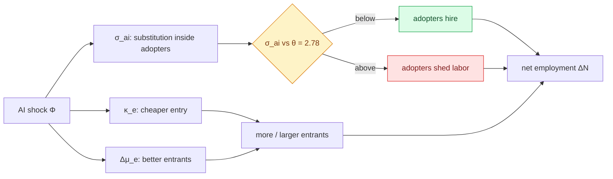

# Math Companion: The AI Employment Offset Paper

*A study guide to §2 (Theory), §4 (AI shock) and §5 (Simulation). The equation tags match the `\label`s in the source. Worked numbers were computed from the formulas and from `data/monte_carlo_raw.csv`. Check every bibliographic detail in Part 2 before you cite it.*

---

## 0. The paper in one paragraph

Firms differ in productivity $z$. Each one hires until the last worker adds exactly the wage in revenue. Returns are decreasing ($\alpha<1$), so more productive firms are bigger but never infinite. Firms enter by paying a sunk cost and leave when they can no longer cover a fixed cost. AI arrives as three shocks: (1) adopting firms can swap AI services for labor inside a CES bundle, (2) entry gets cheaper, and (3) AI-native entrants draw higher productivity. Whether an adopter hires or fires comes down to one comparison: the labor–AI substitution elasticity $\sigma_{ai}$ against $\theta = 1/(1-\alpha)\approx 2.78$. Nobody knows $\sigma_{ai}$, so the paper draws it, along with the other shock parameters, from priors 2,000 times and reports how often net employment rises.

---

## Part 1: The equations

### E1. Productivity process (`eq:productivity-process`)

$$\ln z' = \rho \ln z + (1-\rho)\mu + \varepsilon, \qquad \varepsilon \sim \mathcal{N}(0,\sigma_z^2)$$

- **What it says:** Next year's log productivity is a weighted average of this year's value and a long-run mean, plus a random shock.
- **Why this form:** An AR(1) in logs is the simplest process that is *persistent* (good firms stay good) and *mean-reverting* (no firm grows forever). Working in logs makes shocks proportional, so a 10% shock means the same thing to a corner shop and to Walmart.
- **Variables:** $\rho$ is persistence (0.97). $\mu$ is the long-run mean. $\sigma_z$ is the shock s.d. (0.18). $z'$ is next period's productivity.
- **Useful numbers:** The stationary s.d. of $\ln z$ is $\sigma_z/\sqrt{1-\rho^2} = 0.74$, and a shock's half-life is $\ln 0.5/\ln 0.97 \approx 23$ years. Employment scales with $z^\theta$, so log employment has an s.d. of about $\theta \times 0.74 \approx 2.1$. That is the source of the right-skewed size distribution.
- **Connection:** This process generates the size distribution that sorts firms into the classes $\Omega$ compares.
- **Be ready:** With $\rho<1$ this process yields a (truncated) **lognormal**, not a Pareto tail. Luttmer's Pareto tail needs random growth ($\rho = 1$) plus entry and exit. The honest answer: a high-variance lognormal can mimic Zipf over the size range the model populates.

### E2. Production (`eq:production`)

$$y = z\,n^{\alpha}, \qquad 0<\alpha<1$$

- **What it says:** Output rises with workers, but each extra worker adds less than the last.
- **Why this form:** This is Lucas (1978) "span of control". The manager's attention is the fixed factor, which produces decreasing returns. Decreasing returns are what give each firm a *finite* optimal size. With $\alpha = 1$, the most productive firm would absorb the whole economy.
- **Variable:** $\alpha = 0.64$ is the returns to scale on labor.
- **Connection:** $\alpha$ is the most consequential calibration choice in the paper, because the threshold $\theta = 1/(1-\alpha)$ is built from it (E7).

### E3. Labor demand and the profit function (`eq:labor-demand`)

$$n(z) = \left(\frac{\alpha z}{w}\right)^{\frac{1}{1-\alpha}}$$

- **Derivation (one line):** Set the marginal product equal to the wage, $\alpha z n^{\alpha-1} = w$, and solve for $n$.
- **What it says:** Employment rises with productivity and falls with the wage. Both elasticities equal $\theta = 1/(1-\alpha) = 2.78$.
- **Intuition:** A 1% rise in $z$ brings 2.78% more workers. The response exceeds 1% because a more productive firm values every worker more, and diminishing returns set in slowly when $\alpha$ is near 1.
- **Derived result you will use constantly** (not displayed in the paper):
$$\pi(z) = (1-\alpha)\Bigl(\frac{\alpha}{w}\Bigr)^{\frac{\alpha}{1-\alpha}} z^{\theta} \equiv K(w)\, z^{\theta}, \qquad \pi = \frac{1-\alpha}{\alpha}\, w\, n .$$
Profit is proportional to headcount: with $w=1$, each worker "carries" 0.56 units of profit. Labor takes share $\alpha$ of revenue and profit takes $1-\alpha$.
- **Connection:** $z^\theta$ appears in labor demand, in profit and in the adoption cutoff. $\theta$ plays two roles: it is the wage elasticity of labor demand and also the *scale elasticity*. That double role is the key to the threshold.

### E4. Incumbent value and exit (`eq:value`)

$$V(z) = \pi(z) - c_f + \beta \int \max\{0, V(z')\}\, dF(z'\mid z)$$

- **What it says:** A firm is worth this year's profit net of the fixed cost, plus the discounted expected value of next year, when it can walk away (the $\max$ with 0).
- **Intuition:** The $\max\{0,\cdot\}$ is an *option*: exit works like a put. Firms therefore ride out a few loss-making years, because $z$ might recover. As a result, the exit threshold $z^*$ (where $V(z^*)=0$) sits **below** the static break-even point $\pi(z) = c_f$.
- **Variables:** $c_f = 0.5$ worker-years, $\beta = 0.96$, and $F(z'\mid z)$ is the transition implied by E1.
- **Connection:** $\kappa_f$ scales $c_f$. A lower $c_f$ lowers $z^*$, so more small firms survive. The Monte Carlo holds $\kappa_f = 1$.
- **Be ready:** The simulation **does not solve this Bellman equation**. Its exit rule is myopic (leave when this period's best net profit is below 0) plus exogenous exit $\delta = 0.05$ per year. If asked "did you solve the dynamic problem?", say that the static rule approximates it and that the option value would make exit less sensitive to temporary losses.

### E5. Free entry (`eq:free-entry`)

$$\int V(z)\, dG(z) = c_e$$

- **What it says:** In equilibrium, the expected value of starting a firm equals the cost of starting one.
- **Intuition:** This is the entrepreneurs' zero-profit (arbitrage) condition. If expected value exceeded the cost, more firms would enter and bid up wages or bid down prices until the gap closed.
- **Variables:** $c_e = 20$ worker-years. $G$ is the distribution of entrant productivity.
- **Connection:** A lower $c_e$ ($\kappa_e<1$) brings more entrants, and $\Delta\mu_e$ shifts $G$.
- **Be ready (closure):** In Hopenhayn (1992), free entry pins down a *price*, either the wage or the output price. Here the wage is fixed (perfectly elastic labor supply) and the output price is fixed (a homogeneous numeraire good), so nothing is left to adjust. The simulation therefore uses a different rule. A Poisson pool of would-be entrants, of size $M = 600\,(c_{e,\text{pre}}/c_e)^{0.3}$, draws productivity *first* and enters only if $V(z)\ge c_e$. Two consequences: the timing is draw-then-pay instead of pay-then-draw, and the response of entry to cheaper $c_e$ is capped by the assumed pool elasticity of 0.3. A 30% cost cut grows the pool by only about 11%.

### E6. Employment accounting (`eq:employment`)

$$N = N^{\mathcal L}+N^{\mathcal B}+N^{\mathcal S},\qquad N^{k}=\int_{z:\,n(z)\in k} n(z)\,d\mu(z)$$

- **What it says:** Total employment is the sum over the three size classes. Each class total is headcount integrated over the firms in that class, weighted by the firm distribution.
- **Intuition:** This is pure bookkeeping, as the paper says. All the economics lies in how the shock moves firms between classes.
- **Notation collision:** $\mu$ here is the *invariant distribution of firms*, while in E1 it is the *long-run mean*. A careful reader will notice, so rename one of them.

### E7. The displacement threshold (`eq:threshold`), the heart of the paper

$$\sigma_{ai} < \frac{1}{1-\alpha} \equiv \theta$$

- **What it says:** AI adoption *raises* a firm's headcount if and only if labor and AI are less substitutable than $\theta$.
- **Intuition:** Two forces compete.
  - **Substitution effect** (strength $\sigma$): AI is cheap, so for a given output the firm uses less labor.
  - **Scale effect** (strength $\theta$): the input bundle is now cheaper, so the firm wants to produce more, and more output needs more of every input, labor included.

  Whichever force is larger wins. This is the classic Hicks–Marshall result: two inputs are *gross complements* when the elasticity of substitution is smaller than the price elasticity of demand for output. Here, "output" means the bundle $X$.
- **Sensitivity to α:** $d\theta/d\alpha = \theta^2 \approx 7.7$ at $\alpha=0.64$.

| $\alpha$ | 0.60 | 0.64 | 0.70 | 0.80 | 0.85 |
|---|---|---|---|---|---|
| $\theta$ | 2.50 | 2.78 | 3.33 | 5.00 | 6.67 |

- **Be ready:** The prior $\sigma\sim\mathcal U(2,5)$ was chosen to straddle 2.78. Suppose someone believes total returns of 0.85, a common value in the misallocation literature (Restuccia and Rogerson 2008 use it in a model *with capital*). Then every draw lies below the threshold. Your defense: here $\alpha$ is the return on a labor(+AI) bundle with no capital, which is exactly the setup in which Hopenhayn–Rogerson (1993) use 0.64. Better still, add a robustness run over $\alpha$.

### E8. Task-based production (`eq:tasks`)

$$y = zX^{\alpha}, \qquad \ln X = \int_0^{\phi}\ln a(i)\,di + \int_{\phi}^{1}\ln n(i)\,di$$

- **What it says:** The input bundle is a Cobb–Douglas aggregate over a unit continuum of tasks. AI performs the first $\phi$ tasks and workers perform the rest.
- **Why this form:** In Acemoglu–Restrepo, technology does not make workers better at everything. It *takes over specific tasks*. The log integral is a geometric mean, so every task gets an equal share of spending, and raising $\phi$ moves tasks from labor to AI.
- **Variables:** $\phi$ is the automatable share of tasks. $a(i)$ is AI services in task $i$, at price $r$. $n(i)$ is labor in task $i$, at wage $w$.
- **Derived unit cost:** $c(\phi) = r^{\phi}w^{1-\phi}$, a geometric mean of prices weighted by task shares.
- **Connection:** With $\phi = 0$ this collapses to E2. The structure fixes the elasticity of substitution between tasks at exactly 1.

### E9. Task-based labor demand (`eq:ai-labor-demand`)

$$n(z;\phi) = \frac{1-\phi}{w}\,(\alpha z)^{\frac{1}{1-\alpha}}\,c(\phi)^{-\frac{\alpha}{1-\alpha}}$$

- **Derivation:** Under Cobb–Douglas, spending is equal across tasks, so labor receives a share $(1-\phi)$ of input spending $cX$, where $X = (\alpha z/c)^\theta$. The wage bill is then $(1-\phi)cX$, so $n = (1-\phi)cX/w$. Substitute $X$ and simplify.
- **What it says:** Headcount = labor's task share × total input spending ÷ wage.
- **Intuition:** Two levers pull in opposite directions. $(1-\phi)$ shrinks employment because fewer tasks remain for people. $c^{-\alpha/(1-\alpha)}$ raises it because a cheaper bundle makes the firm bigger.
- **Status:** I re-derived this and it is correct as written, so the `[rigor]` comment in the source can be resolved.

### E10. Displacement vs. productivity effect (`eq:displacement-condition`)

$$\frac{\partial \ln n}{\partial \phi} = -\frac{1}{1-\phi} + \frac{\alpha}{1-\alpha}\ln\frac{w}{r}$$

- **What it says:** Automating one more sliver of tasks lowers employment through a displacement term and raises it through a productivity term.
- **Intuition:**
  - **First term:** you lose the task. It equals $1/(1-\phi)$ because the lost task is a larger share of whatever labor still does.
  - **Second term:** the cost saving per task, $\ln(w/r)$, multiplied by the headcount elasticity with respect to unit cost, $\alpha/(1-\alpha) = 1.78$.
- **Worked number:** At $\phi = 0$, employment rises only if $\ln(w/r) > (1-\alpha)/\alpha = 0.5625$. In words, AI must be at least **1.76× cheaper** than labor per task. When $w/r$ is only slightly above 1, the firm gets displacement with almost no productivity gain. Acemoglu and Restrepo call this "so-so automation".
- **Status:** The algebra is correct. Note that the productivity term needs $w>r$, an assumption the CES block does not share (see E12).

### E11. CES bundle (`eq:ces-bundle`)

$$X = \Bigl[(1-\omega)\,n^{\frac{\sigma-1}{\sigma}} + \omega\,a^{\frac{\sigma-1}{\sigma}}\Bigr]^{\frac{\sigma}{\sigma-1}}$$

- **What it says:** Labor and AI combine into a single input with a *constant* elasticity of substitution $\sigma$.
- **Intuition:** $\sigma$ measures how readily the firm swaps one input for the other as relative prices move: a 1% rise in $w/r$ raises $a/n$ by $\sigma$%. $\sigma=0$ is fixed proportions (Leontief), $\sigma=1$ is Cobb–Douglas, and $\sigma=\infty$ is perfect substitutes. The task model is the $\sigma = 1$ special case, and CES generalizes it with one parameter.
- **Derived formulas:**
  - Unit cost: $c = [(1-\omega)^\sigma w^{1-\sigma} + \omega^\sigma r^{1-\sigma}]^{1/(1-\sigma)}$.
  - Conditional labor demand: $n = (1-\omega)^{\sigma}(w/c)^{-\sigma}X$.
- **Variables:** $\omega$ is the weight on AI. $\sigma_{ai}$ is the labor–AI elasticity.
- **Paper vs. code:** The code has **no weights**: $X = [n^{\rho}+a^{\rho}]^{1/\rho}$, with $a$ in efficiency units, $c = (w^{1-\sigma}+r^{1-\sigma})^{1/(1-\sigma)}$ and $r = 1.5/(S\cdot\text{exposure})$. Align the paper equation with the code, or the code with the paper.

### E12. The CES threshold (`eq:ces-elasticity`)

$$\frac{\partial \ln n}{\partial \ln c} = \sigma_{ai}-\theta$$

- **Whiteboard derivation (memorize this):**
  $$n = (1-\omega)^\sigma w^{-\sigma}c^{\sigma}X,\quad X=(\alpha z/c)^{\theta}\ \Rightarrow\ \ln n = \text{const} + \underbrace{\sigma\ln c}_{\text{substitution}} - \underbrace{\theta \ln c}_{\text{scale}}$$
- **What it says:** When the bundle's unit cost falls by 1%, labor changes by $(\theta - \sigma)$%.
- **Discrete version** (what the code actually computes, in `ai_headcount_ratio`):
$$\frac{n_{ai}}{n_{no}} = \Bigl(\frac{c}{w}\Bigr)^{\sigma-\theta}$$
This ratio **does not depend on $z$**: every adopter in a given sector and period scales its headcount by the same factor. Because $c<w$, the ratio is below 1 exactly when $\sigma>\theta$. The comparison is discrete, so it settles the `[rigor]` worry without leaning on a derivative.

**Worked table** ($r/w = 1.5$, i.e. an exposure-1 sector at full diffusion):

| $\sigma$ | $c/w$ | headcount ratio | profit ratio $K_{ai}/K_{no}$ |
|---|---|---|---|
| 2.00 | 0.60 | 1.49 | 2.48 |
| 2.78 | 0.80 | 1.00 | 1.49 |
| 3.00 | 0.83 | 0.96 | 1.39 |
| 3.50 | 0.88 | 0.91 | 1.25 |
| 4.00 | 0.92 | 0.90 | 1.17 |
| 5.00 | 0.96 | 0.91 | 1.08 |

Two things to notice:

1. Even above the threshold, an adopter in this sector sheds only about 4–10% of its workers, so displacement per adopter is modest. In the most exposed sector ($r/w = 1$) the cut is larger, reaching 32% at $\sigma = 5$.
2. $c/w$ climbs toward 1 as $\sigma$ rises, so **a higher σ means a smaller cost saving from AI**. That is why offset levels off near 68% instead of collapsing, and why adoption falls with $\sigma$: in the Monte Carlo, the mean adoption rate is 39% for $\sigma\le2.78$ and 11% for $\sigma>4.25$.

- **Be ready (normalization):** In the unweighted CES, $\sigma$ governs *both* substitutability *and* how far AI cuts cost (as $\sigma\to1$, $c\to 0$). Part of $\sigma$'s 71% Sobol index therefore measures "how large AI's productivity gain is", not only "does AI augment or replace". Also, AI per efficiency unit is never cheaper than labor in the code ($r\ge w$), yet adoption still cuts costs by up to 50%. That saving comes from CES treating AI as an *added* input, not from AI being cheap. The standard fix is a *normalized* CES (Klump, McAdam & Willman 2012), which pins costs and shares at a baseline point so that $\sigma$ changes curvature only. A CES-literate economist will spot this quickly.

### E13. Adoption cutoff (`eq:adoption-cutoff`)

$$K_{ai}\,\underline z^{\theta} - K_{no}\,\underline z^{\theta} = F_{ai}$$

*The source writes `K_{\text{ai}}(\underline{z})^\theta`, which can be misread as $(K\underline z)^\theta$. Write it as $K_{ai}\,\underline z^\theta$.*

- **What it says:** A firm adopts AI when the profit gain covers the per-period fixed cost of AI.
- **Intuition:** The gain is proportional to $z^\theta$, that is, to firm size, while the fixed cost is not. So only big firms find adoption worthwhile. Exporting in Melitz (2003) follows the same logic.
- **Headcount version** (more useful in conversation; it uses $\pi_{no} = \tfrac{1-\alpha}{\alpha}wn$):
$$n_{no} > \frac{\alpha}{1-\alpha}\cdot\frac{F_{ai}}{w\,\bigl[(c/w)^{-\alpha/(1-\alpha)}-1\bigr]}$$
- **Worked:** With $F=5$ and $r/w=1.5$, a firm adopts above about 6 workers when $\sigma=2$, about 23 when $\sigma=3$, and about 107 when $\sigma=5$. The paper's "concentrated among 100+" therefore depends heavily on $\sigma$ and on sector exposure.

### E14. Offset ratio (`eq:offset-ratio`)

$$\Omega(\Phi) = \frac{\Delta N^{\mathcal B}}{-\Delta N^{\mathcal L}}$$

- **What it says:** Jobs gained at smaller firms (including entrants that grow into the band) per job lost at large firms.
- **Intuition:** $\Omega = 1$ means one-for-one replacement. Firms are classified by **pre-shock** size to avoid the "regression fallacy" (Davis, Haltiwanger & Schuh 1996): otherwise, a large firm that shrinks into the band would show up as band growth.
- **Algebra:** $\Omega\ge1 \iff \Delta N^{\mathcal B}+\Delta N^{\mathcal L}\ge0$.
  - In the simulation, with only two groups (<500 and 500+), that is the same as $\Delta N\ge0$, which is why $\Pr[\Delta N>0]$ serves as the headline.
  - With the theory's three classes, the condition becomes $\Delta N \ge \Delta N^{\mathcal S}$, which is not the same event.
- **Be ready:**
  - $\Omega$ is undefined whenever $\Delta N^{\mathcal L}\ge0$, which happens in 56% of draws. A ratio whose denominator is near zero explodes, which is the right reason to report a probability instead of a mean $\Omega$.
  - The simulation classifies by *current* size. A large firm that shrinks below 500 therefore counts as a gain below 500, which biases $\Omega$ upward. The paper flags this.

### E15. The Offset Proposition (`prop:offset`)

- **What it says:** If $\sigma<\theta$, adopters do not shed workers, so offset is almost automatic. If $\sigma>\theta$, offset requires better entrants, and the required entrant quality rises with $\sigma$.
- **How to describe it:** This is a numerical characterization, not a proven theorem. The cutoff $\bar{\Delta\mu}_e(\sigma)$ comes from simulation, and the second bullet of case (ii) is qualitative. A theorist will ask for a proof, so either relabel it "Result" or add a proof sketch for case (i).

### E16. Monte Carlo estimator (`eq:offset-probability`)

$$\Pr[\Delta N>0]\approx\frac1S\sum_{s=1}^{S}\mathbf 1\{\Delta N(\Phi^{(s)})>0\}$$

- **What it says:** Draw parameter vectors from the priors, simulate each one, and count the share of draws in which employment rises.
- **Precision:** The standard error is $\sqrt{p(1-p)/S} = \sqrt{0.817\cdot0.183/2000}\approx0.0086$, or ±1.7 pp, giving 79.9–83.3%. The paper uses a Wilson interval, which behaves better near 0 and 1 (Brown, Cai & DasGupta 2001).
- **Critical point:** This interval measures **Monte Carlo precision**, i.e. how accurately the prior-weighted share was computed. It says nothing about uncertainty in the real world. With $S = 20{,}000$ it would shrink to ±0.5 pp, while real-world uncertainty would not change at all.
- **The headline is a prior-weighted average:**
$$0.817 = \underbrace{0.274}_{P(\sigma<\theta)}\times\underbrace{0.998}_{P(\text{off}\mid\sigma<\theta)} + \underbrace{0.727}_{P(\sigma>\theta)}\times\underbrace{0.749}_{P(\text{off}\mid\sigma>\theta)}$$
Change the prior and the headline moves. In the raw draws, restricting $\sigma$ to [2, 3.5] gives 93%, and restricting it to [3.5, 5] gives 70%. **The conditional statements are more robust than the headline.**
- **Common random numbers:** The AI and no-AI runs share the same seeds. Because $\mathrm{Var}(Y_{AI}-Y_{cf})=\mathrm{Var}(Y_{AI})+\mathrm{Var}(Y_{cf})-2\mathrm{Cov}$, shared seeds make the covariance large and the difference precise. The logic is the same as a paired t-test or a twin study.
- **Noise:** 60 fixed-parameter runs have an s.d. of 4.2 pp, so simulation noise is about 6% of total variance.

### E17. Sensitivity measures (`tab:sensitivity`)

- **Spearman ρ:** Rank correlation between a parameter and the outcome. It shows direction and monotone strength.
- **First-order Sobol index:** $S_i = \mathrm{Var}(E[Y\mid X_i])/\mathrm{Var}(Y)$, the share of outcome variance that $X_i$ explains *on its own*, averaging over the other parameters. The code estimates it as a bias-adjusted correlation ratio over 20 quantile bins.
- **Linear $R^2$ share:** The squared standardized regression coefficient, i.e. what a linear regression attributes to each parameter.

How to read the table:

- For σ, $S_1 = 0.71$ against a linear share of 0.45, so its effect is strongly **nonlinear**: there is a kink at the threshold.
- The $S_1$ values sum to about 0.92, and noise accounts for about 0.06. Very little of the *variance* of $\Delta N$ is left for interactions. Yet the paper calls the σ×Δμ_e interaction "decisive" for P(offset). Both statements hold, because even an additive model $\Delta N\approx f(\sigma)+g(\Delta\mu_e)$ produces a *sign* that depends on both parameters jointly. Say "they jointly determine the sign" unless you report total-order indices.
- **Sobol indices depend on the prior.** Entry-cost reduction scores 3% partly because its prior range is narrow (0–30%) and the pool elasticity is 0.3. Say "under our priors…", never "entry costs don't matter".

### Paper vs. code: reconcile before presenting

| Item | Paper | Simulation code |
|---|---|---|
| Exit | Bellman equation with option value (E4) | Myopic (exit if net profit < 0) plus 5%/yr exogenous exit |
| Entry | Pay $c_e$, then draw; free entry | Draw first, enter if $V(z)\ge c_e$; Poisson pool $600(c_{e,pre}/c_e)^{0.3}$; entry value is a 40-year sum that ignores the exit option |
| CES | Weights $(1-\omega),\omega$ | No weights; AI in efficiency units |
| Sectors | Absent from §2/§4 | 4 sectors with AI exposure 0.5–1.5 |
| Size classes | 5 / 5,000 | 20 / 500, current size |
| Untabulated parameters | none | $\mu=0.95$, entrant mean 0.75 / s.d. 0.60, $\delta=0.05$, pool 600, $\eta=0.3$ |

---

## Part 2: Reading list

### Hopenhayn–Luttmer firm dynamics
1. **Lucas (1978)**, "On the Size Distribution of Business Firms," *Bell J. Econ.* 9(2). The span-of-control origin of $y=zn^\alpha$.
2. **Jovanovic (1982)**, "Selection and the Evolution of Industry," *Econometrica* 50(3). Learning and selection of young firms.
3. **Hopenhayn (1992)**, "Entry, Exit, and Firm Dynamics in Long Run Equilibrium," *Econometrica* 60(5). *The* framework; read §§1–3 for free entry and the exit threshold.
4. **Hopenhayn & Rogerson (1993)**, "Job Turnover and Policy Evaluation," *JPE* 101(5). The source of $\alpha = 0.64$; a general-equilibrium version with employment.
5. **Melitz (2003)**, *Econometrica* 71(6). The same fixed-cost selection logic as your adoption cutoff.
6. **Luttmer (2007)**, "Selection, Growth, and the Size Distribution of Firms," *QJE* 122(3). How random growth plus entry and exit gives a Pareto tail.
7. **Luttmer (2010)**, "Models of Growth and Firm Heterogeneity," *Annual Rev. Econ.* 2. A readable survey.
8. **Clementi & Palazzo (2016)**, "Entry, Exit, Firm Dynamics, and Aggregate Fluctuations," *AEJ: Macro* 8(3). A modern quantitative Hopenhayn model with pre-entry signals, close to your code's timing.
9. **Restuccia & Rogerson (2008)**, *Rev. Econ. Dynamics* 11(4). The source of the "why not α = 0.85?" question.

### CES and the elasticity of substitution
1. **Hicks (1932)**, *The Theory of Wages*. The original definition of σ and the scale-vs-substitution logic.
2. **Arrow, Chenery, Minhas & Solow (1961)**, *REStat* 43(3). Introduced CES.
3. **Hamermesh (1993)**, *Labor Demand*, Princeton. The Hicks–Marshall laws and cross-price elasticities. Read this to defend E7.
4. **de La Grandville (1989)**, "In Quest of the Slutsky Diamond," *AER* 79(3). Why CES must be normalized.
5. **Klump, McAdam & Willman (2012)**, "The Normalized CES Production Function," *J. Econ. Surveys* 26(5). Essential for the E12 objection.
6. **León-Ledesma, McAdam & Willman (2010)**, *AER* 100(4). How hard σ is to identify.
7. **Karabarbounis & Neiman (2014)**, "The Global Decline of the Labor Share," *QJE* 129(1). An influential σ > 1 estimate for capital and labor.
8. **Oberfield & Raval (2021)**, "Micro Data and Macro Technology," *Econometrica* 89(2). Plant-level σ estimates and their aggregation.

### Task-based automation
1. **Autor, Levy & Murnane (2003)**, *QJE* 118(4). The routine-task hypothesis.
2. **Zeira (1998)**, *QJE* 113(4). An early automation-of-tasks model.
3. **Acemoglu & Autor (2011)**, "Skills, Tasks and Technologies," *Handbook of Labor Economics* 4B. The canonical task framework.
4. **Acemoglu & Restrepo (2018)**, "The Race between Man and Machine," *AER* 108(6). The source of E8.
5. **Acemoglu & Restrepo (2019)**, "Automation and New Tasks," *JEP* 33(2). Displacement vs. reinstatement, and "so-so automation"; the most readable entry point.
6. **Acemoglu & Restrepo (2020)**, "Robots and Jobs," *JPE* 128(6). Local-labor-market evidence.
7. **Acemoglu, Lelarge & Restrepo (2020)**, "Competing with Robots," *AEA P&P* 110. Adopters grow while competitors shrink (business stealing).
8. **Graetz & Michaels (2018)**, "Robots at Work," *REStat* 100(5). Cited in your §2; check what it actually estimates.
9. **Acemoglu (2025)**, "The Simple Macroeconomics of AI," *Economic Policy* 40(121). A task-based estimate of AI's macro effect.
10. **Eloundou, Manning, Mishkin & Rock (2024)**, "GPTs are GPTs," *Science* 384. AI exposure by occupation, behind your sector exposures.

### Monte Carlo methods in economics
1. **Kydland & Prescott (1996)** and **Hansen & Heckman (1996)**, *JEP* 10(1). The calibration debate, both sides.
2. **Canova (1994)**, "Statistical Inference in Calibrated Models," *J. Applied Econometrics* 9(S1). Drawing parameters from distributions, which is exactly your design.
3. **Judd (1998)**, *Numerical Methods in Economics*, MIT Press. The standard reference.
4. **Glasserman (2003)**, *Monte Carlo Methods in Financial Engineering*, ch. 4. Variance reduction, including common random numbers.
5. **Sobol' (2001)**, *Math. & Computers in Simulation* 55. The definition of Sobol indices.
6. **Saltelli et al. (2008)**, *Global Sensitivity Analysis: The Primer*, Wiley. First-order vs. total-order indices.
7. **Harenberg, Marelli, Sudret & Winschel (2019)**, *Quantitative Economics* 10(1). Global sensitivity analysis applied to economic models; your closest methodological template.
8. **Brown, Cai & DasGupta (2001)**, *Statistical Science* 16(2). Why Wilson intervals.
9. **Manski (2013)**, *Public Policy in an Uncertain World*, Harvard UP. How to communicate uncertainty without false precision.

### Business dynamism measurement
1. **Davis, Haltiwanger & Schuh (1996)**, *Job Creation and Destruction*, MIT Press, plus their *Small Business Economics* paper of the same year on the regression fallacy.
2. **Axtell (2001)**, "Zipf Distribution of U.S. Firm Sizes," *Science* 293.
3. **Haltiwanger, Jarmin & Miranda (2013)**, "Who Creates Jobs? Small versus Large versus Young," *REStat* 95(2). Age, not size, is what matters, which is relevant to your framing.
4. **Decker, Haltiwanger, Jarmin & Miranda (2014)**, *JEP* 28(3), and **(2016)**, *AER P&P* 106(5). Declining dynamism.
5. **Moscarini & Postel-Vinay (2012)**, *AER* 102(6). Job creation by large vs. small employers over the cycle.
6. **Pugsley & Şahin (2019)**, "Grown-up Business Cycles," *RFS* 32(3).
7. **Akcigit & Ates (2021)**, "Ten Facts on Declining Business Dynamism," *AEJ: Macro* 13(1).
8. **Bayard et al. (2018)**, NBER WP 24364. Business Formation Statistics (EIN applications).
9. **Bonney et al. (2024)**, "Tracking Firm Use of AI in Real Time," NBER WP 32319. The BTOS AI module.

---

## Part 3: How to talk like an economist

### 3.1 Jargon and what it really means

| Term | What it means | Where it bites in your paper |
|---|---|---|
| **Partial vs. general equilibrium (PE/GE)** | PE holds some prices fixed; GE lets every price adjust | Wages and the output price are fixed, so you are in PE. Say so up front. |
| **Comparative statics** | How the equilibrium shifts when one parameter changes | The `\placeholder` in §4.4 asks for exactly this. |
| **Calibration vs. estimation** | Choosing parameters to match moments vs. inferring them, with standard errors, from data | α and $c_e$ are calibrated; σ is neither, so it gets a prior. |
| **Identification** | Whether the data could, in principle, pin down a parameter | "What would identify σ?" is the question you will get most often. |
| **Structural vs. reduced form** | A model with primitives vs. a statistical relationship | Your model is structural; BTOS is reduced form. |
| **Intensive vs. extensive margin** | How much (headcount per firm) vs. whether (entry, exit, adoption) | Displacement is intensive; firm formation is extensive. |
| **Scale vs. substitution effect** | Output grows vs. the input mix shifts | The two sides of E7. |
| **Gross complements/substitutes** | A cheaper input raises/lowers demand for the other *after* output adjusts | σ < θ means AI and labor are gross complements, even though σ > 1 (net substitutes). |
| **Selection** | Who enters, survives or adopts is not random | The adoption cutoff and exit threshold are selection mechanisms. |
| **Composition effect** | An average moves because the mix moved, not because units changed | Mean firm size can fall even if no firm shrinks. |
| **Normalization** | Fixing units so that a parameter means only one thing | The CES objection (E12). |
| **Knife-edge** | A result that holds only at one exact parameter value | Not your threshold, which is a robust inequality. Say that. |
| **Business stealing** | One firm's gain is another's loss through market share | Missing from your model. |
| **Displacement / reinstatement** | Tasks taken by machines / new tasks created for labor | You have displacement but no reinstatement channel. |
| **Support (of a prior)** | The range of values the prior allows | U(2,5) puts zero probability on σ < 2. |

### 3.2 Signals of sophistication vs. rookie tells

| Rookie | Sophisticated |
|---|---|
| "The model proves AI will create jobs." | "In the model, net offset follows when σ < θ; above θ it depends on entrant quality." |
| "There's an 82% chance AI raises employment." | "Under our priors, 82% of the parameter mass delivers net offset. That number is a property of the prior: 93% if σ ∈ [2, 3.5], 70% if σ ∈ [3.5, 5]." |
| "The 95% CI is 79.9–83.3%." (unqualified) | "That interval is Monte Carlo error only. It is not uncertainty about the world." |
| "Small firms create most jobs." | "Young firms create most jobs; conditional on age, size matters little (Haltiwanger et al. 2013)." |
| "AI is a substitute for labor, so jobs fall." | "σ > 1 makes them net substitutes, but employment depends on gross substitutability, i.e. σ vs. θ." |
| "Entry costs don't matter." | "Under our priors, entry-cost reduction explains about 3% of the variance in net employment, though it matters more for *where* employment sits." |
| "BTOS shows σ is below the threshold." | "BTOS is consistent with σ < θ, but a survey share isn't a structural elasticity." |
| Calling elasticity "flexibility" | "A 1% change in X produces a σ% change in Y." |

Two habits mark an insider. First, **name the channel**: "this works through the scale effect". Second, **sign the bias**: "relaxing that assumption would push Ω down".

### 3.3 Presenting uncertainty

Keep **three layers** apart, and say which one you mean:

1. **Simulation error.** The CIs in Table 2 measure this. It is small and shrinks with more draws.
2. **Parameter uncertainty.** This is what the priors encode, and it is what the 81.7% summarizes.
3. **Model uncertainty.** PE wages, homogeneous goods, no business stealing, and the CES form. No number in the paper captures this layer, so name it.

**Templates for conditional claims:**
- "*If* σ is below about 2.8, offset is close to certain in our model; *if* it is above, the outcome hinges on whether AI-native entrants are at least 10 log points more productive."
- "The headline is a weighted average of two regimes. I'd rather you remember the regimes than the average."
- "Here is what would change my mind: employment at adopting establishments falling relative to matched non-adopters."

**Rounding rule:** In conversation, say "roughly four in five", not "81.7 percent". Excess precision signals that you don't know which layer the uncertainty lives in.

### 3.4 Handling "what about X?"

**Protocol: Acknowledge → Locate → Sign → Size → Remedy.**
1. "Good point."
2. Locate it: "That's about the closure, i.e. the fixed wage."
3. Sign it: "It would push Ω up/down because…"
4. Size it, *only* if you know: "…we haven't quantified that."
5. Remedy: "The code supports a finite labor-supply elasticity; that's the next robustness run."

Never guess a magnitude. "I don't know the size, but I know the sign" is a strong answer.

**Objections to expect:**

1. **"Wages are fixed."** GE turns part of *every* employment change, gains as well as losses, into a wage change, so the magnitudes shrink. With an upward-sloping labor supply, the *sign* of the net effect is set by whether labor demand at the old wage rises. P(offset) should therefore be roughly preserved, but this is untested in the dynamic model. The code already supports a finite elasticity. With a fixed labor force, employment is pinned and the whole question becomes about wages.
2. **"Who buys the extra output?"** With downward-sloping demand of elasticity $\varepsilon$, effective returns fall to $\alpha(1-1/\varepsilon)$, so θ falls and **offset gets harder**. Concede the direction.
3. **"Business stealing."** Adopters' gains partly come out of competitors' hides (Acemoglu, Lelarge & Restrepo 2020). Your model has no such channel, so it overstates aggregate gains when σ < θ.
4. **"Why α = 0.64?"** See E7. Know the table, and offer an α robustness run.
5. **"Your CES isn't normalized."** See E12. Concede that σ partly proxies AI's cost advantage.
6. **"Why uniform on [2, 5]?"** It was chosen to straddle θ. Point to the conditional results, which do not depend on the prior's weights.
7. **"Is the entry channel small because you made it small?"** Partly, yes. A narrow prior and a pool elasticity of 0.3 limit it. Sobol indices inherit the prior.
8. **"BTOS: only 2% cut jobs."** The survey compares against the *past*; the model compares against a *counterfactual*. A growing adopter can shed jobs relative to the counterfactual and still report no cut. Early adopters are also selected.
9. **"Is the Proposition proven?"** No. It is a numerical characterization (E15).

### 3.5 Example exchanges

**Labor economist:** "Where does your σ come from?"
**You:** "Nowhere yet, and that's the point of the paper. We don't calibrate it; we show the answer splits at σ = 1/(1−α). Below 2.8, adopters hire and offset is near-certain. Above it, it depends on entrant quality. The most useful empirical object is employment at adopters relative to matched non-adopters, because that identifies which side of the threshold we're on."

**Macro theorist:** "This is partial equilibrium."
**You:** "Yes, wages are fixed, so every shift in labor demand shows up fully as employment. With an upward-sloping labor supply, part of each gain or loss shows up in wages instead. That shrinks the magnitudes but shouldn't flip the sign of the net effect, which is what our probability counts. I'd worry more about the output price we hold fixed: with downward-sloping demand, the scale effect weakens and the threshold falls, which makes offset harder."

**Skeptic:** "82% sounds made up."
**You:** "It's a prior-weighted average, and I'd discount it accordingly. The robust content is conditional: 99.8% offset below the threshold, about 75% above, and about 28% when σ > 3.5 and entrants gain little. Put your own prior on σ and you can compute your own headline from those pieces."

**IO economist:** "Your adopters don't steal market share."
**You:** "Correct, there's no product-market interaction. Adding it would move employment from non-adopters to adopters, which lowers net gains when σ < θ. It's a real limitation, and I'd list it next to the PE assumption."
